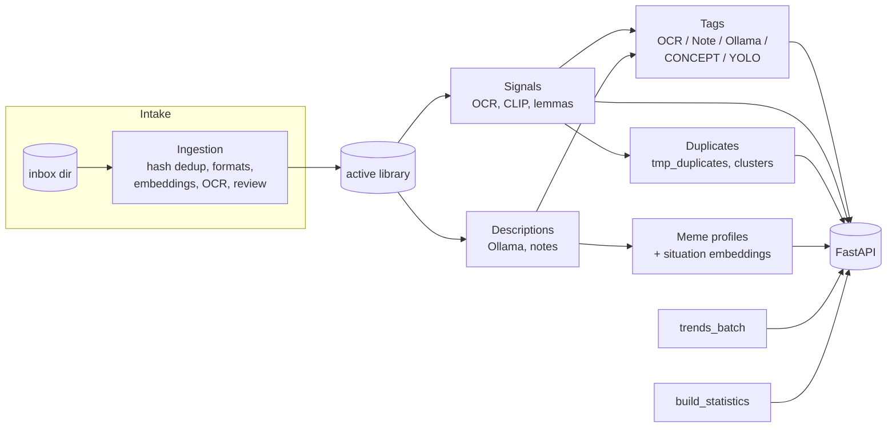
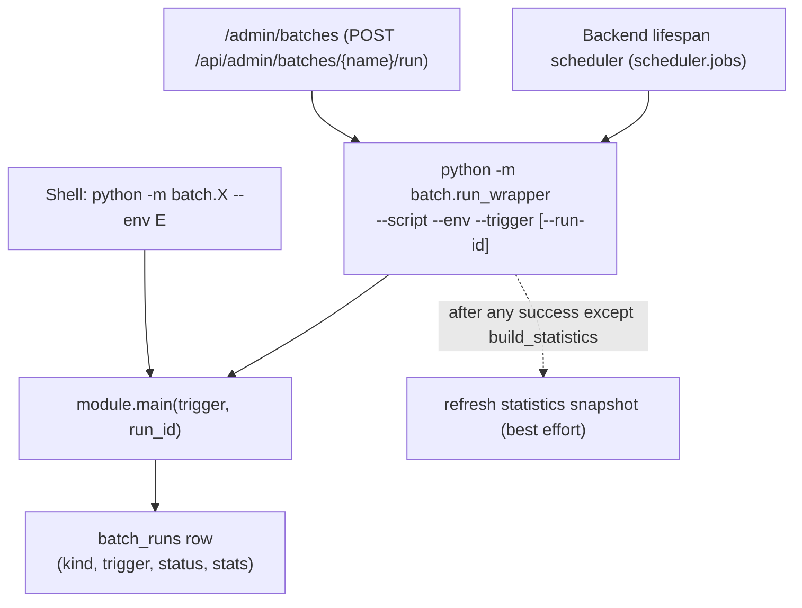

# Batch jobs: documentation index

Status: draft (verified against the code on 2026-10-10)

Everything that enriches the library offline (OCR, embeddings, lemmas, tags, descriptions, meme profiles,
duplicate clusters, trends, statistics) is a batch job under `batch/`. The FastAPI backend only serves what
these jobs pre-computed. This folder is the map of those jobs.

| Document | Read it when you want to know |
|---|---|
| [inventory.md](inventory.md) | Every script: what it does, how to run it, whether it is run-tracked, admin-triggerable or scheduled, per environment |
| [execution-model.md](execution-model.md) | How a job actually runs: CLI vs `run_wrapper` vs scheduler vs `/admin/batches`, run tracking, locks, chaining |
| [use-cases/ingestion.md](use-cases/ingestion.md) | Bringing new images in (inbox to active), with the stage machine and the review tiers |
| [use-cases/ocr-lemmas-tags.md](use-cases/ocr-lemmas-tags.md) | OCR, lemmatisation (smart search), rule-based tagging, concept tagging |
| [use-cases/descriptions-and-profiles.md](use-cases/descriptions-and-profiles.md) | Ollama descriptions, notes, description embeddings, meme-from-text profiles, `description_pipeline` |
| [use-cases/duplicates-and-clusters.md](use-cases/duplicates-and-clusters.md) | Near-duplicate candidates, clustering, the text-heavy classifier and OCR-text probe |
| [use-cases/maintenance-and-cleanup.md](use-cases/maintenance-and-cleanup.md) | Flag/move/unregister, format fixes, resets, backfills |
| [use-cases/concept-discovery.md](use-cases/concept-discovery.md) | Human-in-the-loop vocabulary growth (`build_bow` to drafted concepts) |
| [use-cases/trends-and-statistics.md](use-cases/trends-and-statistics.md) | The two scheduled jobs |
| [gaps-and-findings.md](gaps-and-findings.md) | Things found while writing this: doc drift, undocumented behaviour, risks |

Related, older documents (still authoritative for the topics they cover):
`docs/data-flow.md` (which signal feeds which consumer), `docs/runbooks/ingestion-pipeline.md` (operator steps),
`batch/rules_engine.md` (tagging engine), `CLAUDE.md` section "Batch pipeline" (long per-script notes),
`docs/superpowers/specs/` (design specs; linked from the use-case pages).

## The 60-second picture

## Ways a job gets started

Only scripts listed in `environments/batch_registry.yaml` can be started by the wrapper (and therefore from the
admin UI or the scheduler). Everything else is shell-only.
