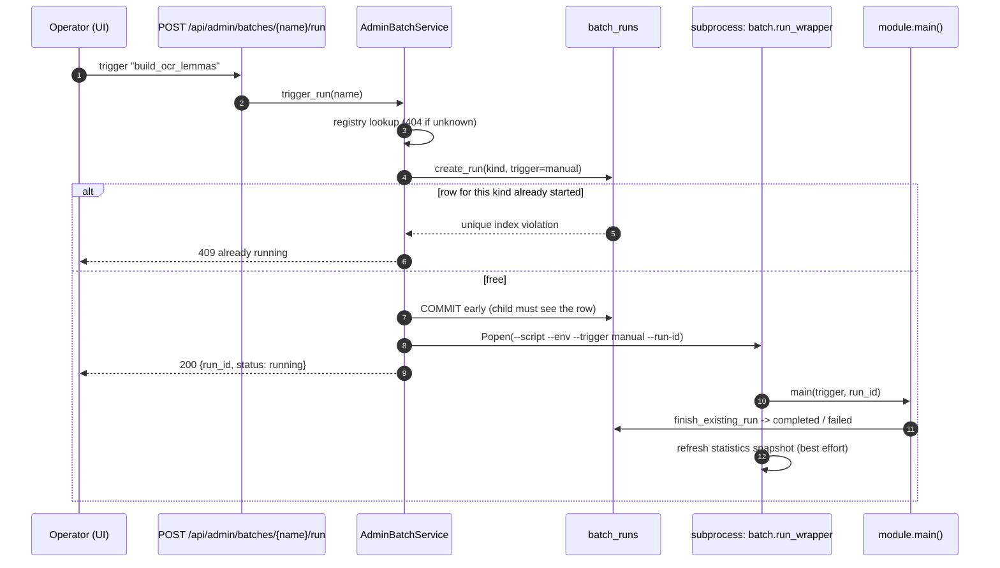
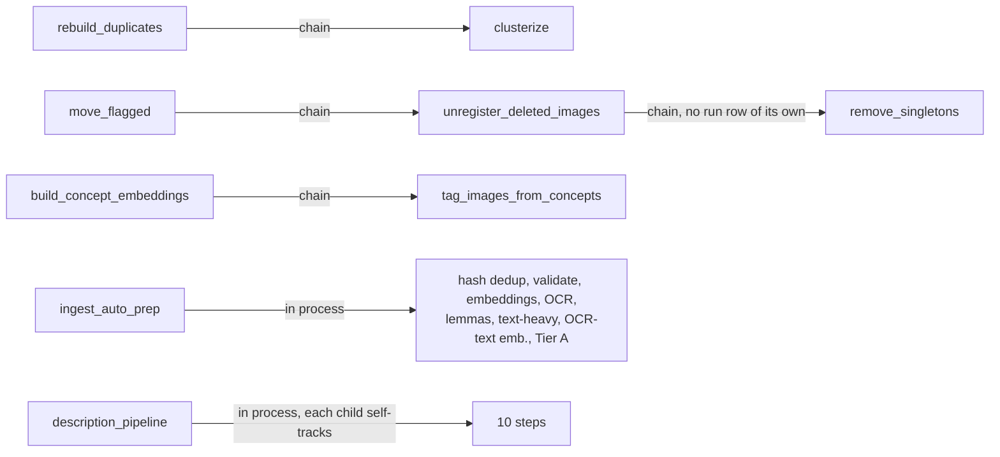

# Batch execution model

Status: draft (verified 2026-10-11)

How a batch job is started, tracked, locked and chained. Files: `batch/run_wrapper.py`, `batch/run_tracking.py`,
`batch/registry.py`, `repository/batch_runs.py`, `Backend/app/scheduler.py`, `Backend/app/batch_subprocess.py`,
`Backend/app/services/admin_batch_service.py`, `Backend/app/api/admin.py`.

Image statuses (`--status active|pending|cut_proposed`) are defined in `docs/image-status.md`; this document does not redefine them.

## 1. The contract a "wrappable" job must satisfy

```python
async def main(trigger: str = "manual", run_id: uuid.UUID | None = None, ...) -> None:
    if run_id is not None:                       # admin path: row already exists
        async with finish_existing_run(run_id): ...
    else:                                        # scheduler or CLI: create the row
        async with tracked_run(kind="<kind>", trigger=trigger): ...
```

`tracked_run` creates a `batch_runs` row (`status=started`), yields its id, then marks it `completed` or `failed`
(error text stored). `finish_existing_run` does the same for a row the caller already created. `record_stats` merges
extra stats into the row. Any extra `main()` parameters (`incremental`, `status`, `limit`, `chain`) keep their defaults
when started through the wrapper, because `run_wrapper` calls only `module.main(trigger=..., run_id=...)`.

Consequence: you cannot pass `--limit`, `--status`, `--full` and similar from the admin page or the scheduler.

## 2. Start paths

Summary diagram (Graphviz): [diagrams/job-start-paths.svg](diagrams/job-start-paths.svg)



```mermaid
sequenceDiagram
    autonumber
    participant Life as Backend lifespan
    participant Loop as _job_loop (one asyncio task per job)
    participant DB as batch_runs
    participant Sub as subprocess: batch.run_wrapper
    Life->>Loop: start_scheduler() if SCHEDULER.ENABLED
    Loop->>DB: most recent run of kind
    Loop->>Loop: sleep(remainder of interval)  (restart-safe)
    loop every interval_minutes
        Loop->>DB: active run of kind?
        alt none
            Loop->>Sub: Popen(--trigger scheduled)  (no --run-id)
            Sub->>DB: tracked_run creates its own row
        else active and younger than max_runtime
            Loop->>Loop: skip this tick
        else active and older than max_runtime
            Loop->>DB: mark failed "orphaned", then spawn
        end
    end
```

Details that matter in practice:

- **The scheduler lives inside each backend process.** Three environments mean three independent schedulers on three
  databases. The Docker image runs several workers without a cross-worker lock, hence `scheduler.enabled: false` in
  the common settings.
- **The job list can differ per environment.** `general` appends `export_ratings` (daily) and `import_judgments`
  (weekly) to the common list through `settings.general.yaml` (Dynaconf merge), so `general` runs four scheduled
  jobs and `metal` and `it` two. Both extra modules follow the wrapper contract above (`main(trigger, run_id)`,
  kind equal to `batch_run_kind`) and check `APP_ENV` against the gold corpus's environment, so started anywhere
  else they finish as a no-op (`skipped: true`) instead of writing files.
- **Children outlive the backend.** `spawn_and_track` uses `subprocess.Popen` plus a daemon waiter thread, so a
  backend reload or shutdown never kills a running job (and shutdown does not block on it).
- **Logs**: `logs/<env>/<script>_<timestamp>.log`, one file per invocation, stdout and stderr together, UTF-8 forced.
  There is no stored link from a `run_id` to its log; correlate by script name and `created_at`.
- **Registry is re-read on every call**: editing `environments/batch_registry.yaml` takes effect without a restart.
  A `batch_registry.<APP_ENV>.yaml` overlay is supported by the loader, but none exist today.
- **The admin API only lists registry kinds**: `GET /api/admin/batches/runs` filters to `kind in registry`. Runs of
  `ingestion`, `fix_image_formats` and similar unregistered kinds do not show up there.
- **Statistics refresh**: after any wrapped job succeeds (except `build_statistics`), the wrapper calls
  `refresh_snapshot()`. Failures are logged and swallowed. Jobs started straight from a shell bypass this.

## 3. Concurrency: one active run per kind

A partial unique index on `batch_runs` allows one `started` row per `kind`. `create_run` surfaces a violation as
`BatchAlreadyRunningError`. Who handles it:

| Caller | Behaviour |
|---|---|
| Admin endpoint | HTTP 409 |
| Scheduler | Pre-checks `get_active_run`, so normally skips the tick |
| Chained call (`rebuild_duplicates` to `clusterize`, `move_flagged` to `unregister_deleted_images`, `build_concept_embeddings` to `tag_images_from_concepts`) | Prints "Skipping chained ..." and continues |
| `description_pipeline` children | Step becomes `skipped_busy`, not a failure |
| `ingest_auto_prep` children | Prints that the child is busy and ends the tick quietly (run completes); the next trigger resumes. Running Tier A over images that still lack lemma/OCR-text coverage would weaken review |
| Direct CLI | Raises |

Orphan recovery exists only in the scheduler's tick (`max_runtime_minutes`). A run started from the CLI or admin that
dies leaves a `started` row that blocks that kind until someone fails it or the scheduler's guard fires. For kinds not
on the schedule, that means manual cleanup in `batch_runs`.

## 4. Chaining



All four automatic chains can be turned off from the CLI with `--no-chain` (`ingest_auto_prep` and
`description_pipeline` have no such switch). The chained child inherits the parent's `trigger` value and is tracked
under its own kind. `remove_singletons` has no run row; it prints metrics only.

Driver differences:

| | `ingest_auto_prep` | `description_pipeline` |
|---|---|---|
| Order semantics | Strict chain; stops quietly when there is no active ingestion run | Dependency graph; a failure only skips dependents |
| Child tracking | Steps are in-process calls. Tracked ones (embeddings, OCR, lemmas, text-heavy, OCR-text embeddings) write their own rows; hash dedup (its own `ingestion` row), validate and Tier A are separate. A `BatchAlreadyRunningError` from a child ends the tick quietly | Each child self-tracks under its own kind; a busy child is `skipped_busy` |
| Result recording | Driver row only | `stats.steps` with `ok / failed / skipped_dependency / skipped_busy / skipped_not_configured` |
| Failure | First real error aborts the run (a busy child is not an error) | Run fails at the end if any step failed |

## 5. Quick reference: starting things

```powershell
# direct (shell)
$env:PYTHONIOENCODING = "utf-8"
python -m batch.build_ocr_lemmas --env metal --incremental

# via the running backend (needs its port; see environments/Environments.md)
curl -X POST http://localhost:8081/api/admin/batches/build_ocr_lemmas/run
curl http://localhost:8081/api/admin/batches/runs?limit=5
```

Never bind your own server to the metal/general/it ports to test this; they are always occupied.

## Business metrics

`process_events` (one row per process, event and subject, kept forever) records the outcome of a process on one subject, for
example a recut proposal being proposed, approved or rejected. Process code calls `BusinessMetricsService.record(process,
event, batch_run_id, subject_id)` in the same transaction as the state change; recording is idempotent per subject and event, and a subject cannot carry both `approved` and `rejected` (`ConflictingEventError`).
The allowed processes, events and rate formulas live in the `PROCESSES` registry in
`Backend/app/services/business_metrics_service.py`. Counts and rates per batch run are computed on request by
`GET /api/admin/batches/metrics` and shown as the "Recut outcomes" panel on `/admin/batches`; nothing is stored. A decision is
attributed to the detection run that produced the proposal. Design: `docs/superpowers/specs/2026-10-17-screenshot-recut/2026-10-18-m1-business-metrics-design.md`.
