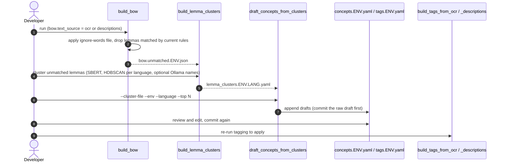

# Use case: concept discovery (vocabulary growth)

Status: draft (verified 2026-10-10). Specs: `2026-07-01-build-lemma-clusters.md`, `2026-07-03-draft-concepts-from-clusters.md`,
`2026-07-05-build-lemma-clusters-cli-overrides.md`. Automated by the `/draft-lemma-concepts` Claude command.

Execution order (Graphviz): [diagrams/concept-discovery.svg](../diagrams/concept-discovery.svg)

Goal: find frequent words the tagging vocabulary does not cover, group them, and draft new concept/tag YAML entries
for a human to review. Deliberately not scheduled: drafts would pile up with no review UI.

| Step | Run | Admin | Notes |
|---|---|---|---|
| `build_bow` | shell, admin | yes | Admin path uses configured `bow.*`. Output paths are per environment |
| `build_lemma_clusters` | shell only | no | `lemma_clustering.selection_method: leaf` avoids one catch-all cluster (`eom` tends to produce it). Flags: `--language`, `--min-cluster-size`, `--ollama-enabled`, `--lookup-concepts`, `--text-scope` and others |
| `draft_concepts_from_clusters` | shell only | no | Appends; does not overwrite. Default data dir `batch/data/tagging` |

Gotcha: edits to `bow.ignore_file` only take effect after the next `build_bow`, because `build_lemma_clusters` reads
`build_bow`'s output and never the ignore file. A stale unmatched file keeps resurfacing ignored words.

Environment: tagging YAML exists for `metal` and `general`; `lemma_clustering` has a `general` override
(`output/lemma_clusters.general.ru.yaml`). Nothing here applies to `it`.
