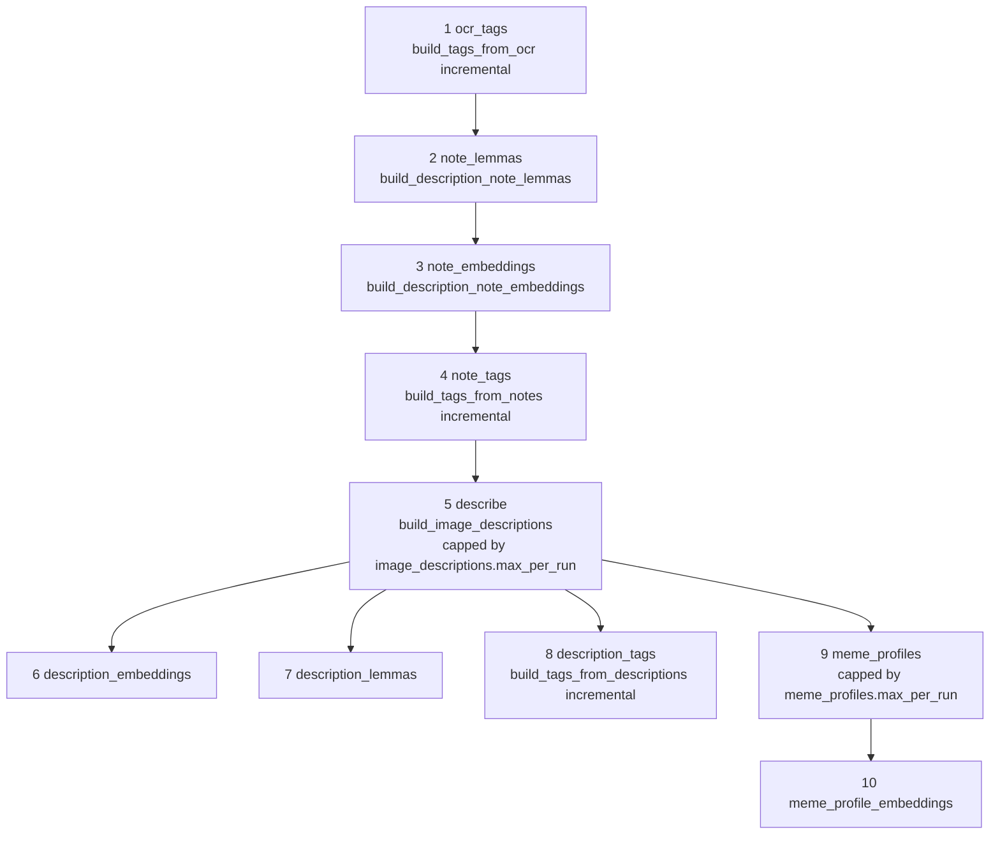
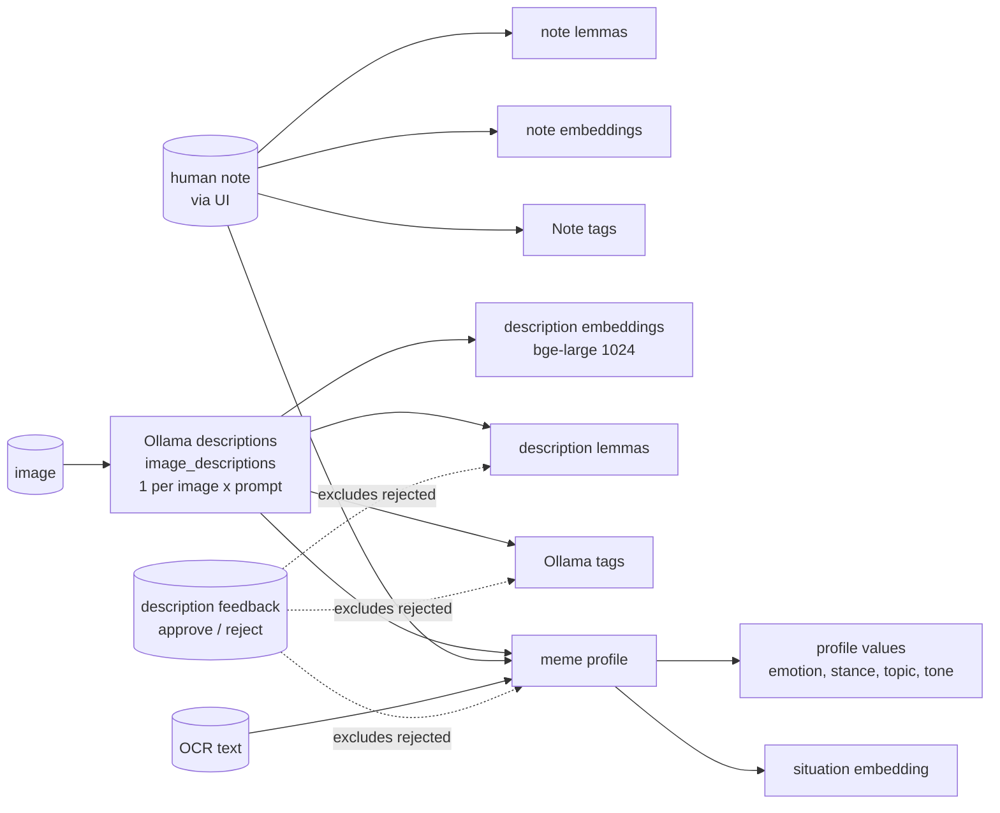

# Use case: descriptions, notes and meme-from-text profiles

Status: draft (verified 2026-10-10). Specs: `2026-07-13-multi-prompt-image-descriptions-design.md`,
`2026-08-20-description-notes-design.md`, `2026-10-01-description-tagging-pipeline-driver-design.md`,
`2026-10-02-meme-from-text/` (P1 to P6).

Execution order (Graphviz): [diagrams/description-pipeline.svg](../diagrams/description-pipeline.svg)

Goal: derive text understanding of each image beyond OCR: LLM descriptions, human notes, and a structured
"meme profile" that powers the `/reply` meme-from-text search.

## `description_pipeline`: the driver

One admin trigger (manual only, not scheduled). Active images only, so run it after `ingest_promote`.

Arrows out of step 5 are the `needs` edges; steps 1 to 4 are plain ordering. Steps 1 to 4 are cheap and GPU-free, so
they run first: if the long describe step is interrupted, the independent work is already done. A failed step skips
only its dependents. A step whose kind is already running becomes `skipped_busy`. Per-step results are in the driver
row's `stats.steps`. Excluded from the chain: `tag_images_from_concepts`, `detect_entities_and_tag`, concept drafting.

The describe and profile steps are capped per run when `image_descriptions.max_per_run` / `meme_profiles.max_per_run`
is set; trigger again until the backlog is empty. Both are unset by default (unlimited).

## Signal flow

## Jobs

| Job | Notes | Shell | Admin | Sched |
|---|---|---|---|---|
| `build_image_descriptions` | Prompts and model per environment (`image_descriptions.*`; overrides only in `settings.general.yaml`). A failed (image, prompt) pair is marked failed after one attempt; `--retry-failed` retries, `--reset` clears, `--limit` caps. Active images only. Needs a live Ollama | yes | yes (no limit) | no |
| `build_image_description_embeddings` | Used only by `/similar?source=description` | yes | yes | no |
| `build_description_lemmas` | Incremental by construction; rejected descriptions excluded at query time. No `--status pending` | yes | yes | no |
| `build_description_note_lemmas` | Also refreshed inline by `PUT .../description-note` | yes | yes | no |
| `build_description_note_embeddings` | Only non-empty notes | yes | yes | no |
| `build_tags_from_notes` | CLI default is full; admin and driver are incremental. Clearing a note deletes its `Note` tags immediately | yes | yes | no |
| `build_tags_from_descriptions` | Any feedback change deletes that image's `Ollama` tags; the next run rebuilds them | yes | yes | no |
| `build_meme_profiles` | Text-first, vision fallback when usable text is shorter than `meme_profiles.min_text_chars`. Staleness derived from taxonomy version, prompt version, model and input fingerprint. Human-verified profiles are never rewritten. Failures carry context and are retried automatically when inputs, prompt or model change. Three consecutive connection errors stop the run | yes | yes | no |
| `build_meme_profile_embeddings` | Re-embeds when the stored model name or digest differs | yes | yes | no |
| `build_taxonomy_similarity` | Regenerates committed `similarity.json`; needs live Ollama; only after taxonomy edits | yes | no | no |

Both meme-profile jobs accept `--ids-file PATH` (JSON list or one UUID per line, at most 20000). The
`python -m evaluation` harness uses this to profile its frozen corpus.

## Environment caveats

| | metal | general | it |
|---|---|---|---|
| Ollama description prompts/model | common defaults | `qwen2.5vl:7b`, general prompt file | common defaults |
| `meme_profiles.text_model` | `qwen2.5:7b-instruct` | `qwen2.5:7b-instruct` | unset, both profile jobs exit cleanly |
| Tagging steps (1, 4, 8) | yes | yes | not expected to work (no tagging YAML for profile `it`) |

On `it`, triggering `description_pipeline` should therefore be expected to report failures for the tagging steps
(not exercised while writing this page).

## Backlog behaviour after ingestion

Ingestion does not run any of this (board task 148: no description job supports `--status pending`). New images join
these jobs after `ingest_promote`, on the next manual run.
