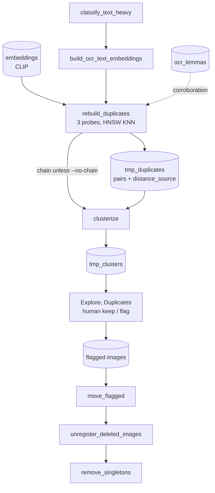
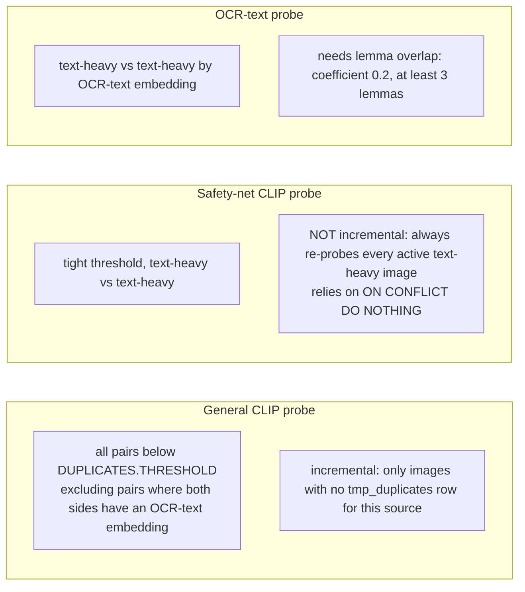

# Use case: duplicates and clusters

Status: draft (verified 2026-10-10). Specs: `2026-07-25-duplicate-clustering-incremental-design.md`,
`2026-09-15-text-heavy-classifier.md`, `2026-09-17-ocr-text-embeddings.md`,
`2026-09-18-text-embedding-duplicate-matching.md`, `2026-09-19-ocr-lemma-overlap-corroboration.md`,
`2026-09-20-clusterize-oversized-cluster-data-loss.md`.

Execution order (Graphviz): [diagrams/duplicates-refresh.svg](../diagrams/duplicates-refresh.svg)

Two independent notions of "duplicate":

| | Exact | Near |
|---|---|---|
| Signal | SHA-256 of bytes (`images.content_hash`) | CLIP vectors and OCR-text vectors |
| Jobs | `ingest_hash_dedup` (intake), `detect_file_duplicates` (existing corpus) | `rebuild_duplicates`, `ingest_find_duplicates`, then `clusterize` |
| Outcome | Duplicates rejected or flagged | Candidate pairs, clusters for human review in the UI |

## Near-duplicate pipeline for the active library

### The three probes (each `rebuild_duplicates` run)

Do not "simplify" the safety net into sharing the general probe's incremental marker: that would silently and
permanently disable it for affected images. `--k` and `--threshold` override only the general probe. `--full` clears
the active-library pairs and re-probes everything. A recut source and its cut (an `image_cuts` row with both ids) are
never inserted as a candidate pair, whichever probe finds them (screenshot recut R5b).

### Clustering rules (`clusterize`)

- Union-find over `tmp_duplicates`, gated per `distance_source`: CLIP pairs under `PROXIMITY_THRESHOLD` (0.05),
  OCR-text pairs under `PROXIMITY_THRESHOLD_OCR_TEXT` (0.05, a separate constant).
- Clusters larger than `clustering.splitting.max_cluster_size` are re-clustered at progressively tighter thresholds
  (step `decrement`, stop at `floor`, or when a tightening step severs every remaining edge). Such clusters are accepted
  oversized instead of split further. Members left without an edge become implicit singletons, never size-1 clusters.
- `clustering.splitting.enabled: false` restores write-everything-as-is.

## Run matrix

| Job | Shell | Admin | Sched | Chain |
|---|---|---|---|---|
| `classify_text_heavy` | `--status` | yes | no | none |
| `build_ocr_text_embeddings` | `--status` | yes | no | none |
| `rebuild_duplicates` | `--full --k --threshold --no-chain` | yes | no | `clusterize` |
| `clusterize` | yes | yes | no | none |
| `ingest_find_duplicates` | `--tier tier_a\|tier_b --k` | via `ingest_find_duplicates_tier_b` / `ingest_auto_prep` | no | none |
| `detect_file_duplicates` | yes | no | no | none |
| `move_reference_duplicates` | `--reference-dir --dry-run`; moves unregistered `BASE_PATH` files identical to a reference-dir file into `possible_duplicates/` | no | no | none |
| `deduplicate_ocr_texts` | yes | no | no | none |

Recommended full refresh on the existing corpus:
`classify_text_heavy` then `build_ocr_text_embeddings` then `build_ocr_lemmas --incremental`, then
`rebuild_duplicates` (which chains `clusterize`). For an in-flight ingestion batch, the same three prerequisite steps
run with `--status pending` (see [ingestion.md](ingestion.md)).

## Review metrics (library `/duplicates` page)

The owner's decisions on the page are recorded as business metrics (process `library_duplicates`, M2b) and shown in the
"Library duplicates" panel of `/admin/batches`.

- **What counts.** `confirmed`: each image flagged with reason `duplicate_review` plus its keeper. `dismissed`: every member of a
  dismissed set. Flags by the `/review-duplicates` agent and by `detect_file_duplicates` count for nothing.
- **Symmetric groups.** Both sides count the images of a decided group, so a confirmed and a dismissed group of equal size weigh
  the same. `confirm_share` = confirmed / (confirmed + dismissed) is a share of decided images, not detector precision.
- **Attribution.** To the latest completed `clusterize` run at decision time (unattributed before the first one). A started or
  failed run never receives decisions.
- **Undo.** Unflagging retracts the loser's `confirmed`, and the keeper's once no page flag points at it; undoing a dismissal
  retracts the `dismissed` of images with no decision pair left.
- **Limits.** An image counts once per event, under the run of its first decision. The keeper counts only when the
  flag's popularity edge was really written (a failed recording, a missing image or an image already discarded into another
  tree confirms the loser alone). An image keeps its `confirmed` while any page flag still involves it, as loser or keeper. A failed metrics write is logged and skipped, so a count can be
  one short.

## Byte-level duplicates

`detect_file_duplicates`: hashes every registered file (backfilling `content_hash`), groups identical hashes, verifies
content, keeps the oldest by `created_at` and flags the rest. A group that already has a flagged member is treated as
reviewed and skipped. It also records the keeper as the winner of each flagged copy (popularity; metrics key
`popularity_skipped` counts recordings that failed and were skipped). Follow with `move_flagged`.

## Related

- `/review-duplicates` command (`.claude/commands/review-duplicates.md`, fed by `tools/agent_duplicates.py`) reviews one
  cluster and marks lower-quality images excluded.
- Safe-guarding note: duplicates never use descriptions or notes (`docs/data-flow.md` section 3).
- `docs/adr/adr-2026-07-10-tmp-duplicates-fk-index.md` covers the `tmp_duplicates` FK index incident and recovery.
