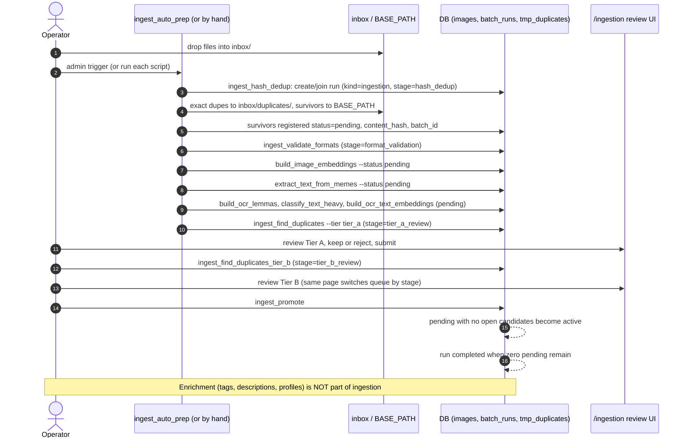
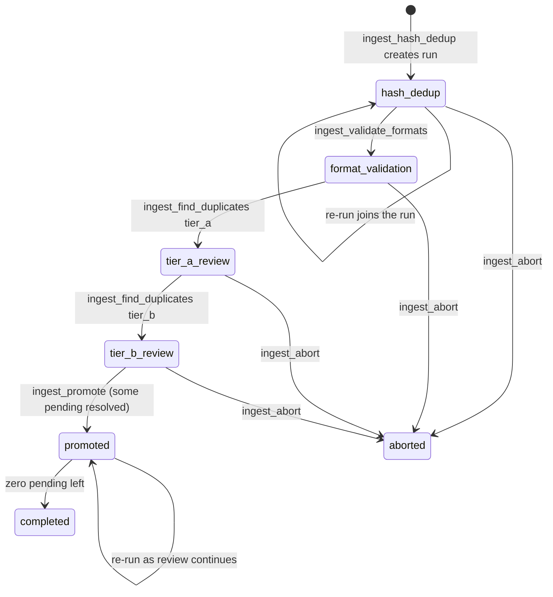

# Use case: ingestion (inbox to active library)

Status: draft (verified 2026-10-10). Operator steps: `docs/runbooks/ingestion-pipeline.md`.
Design: `docs/superpowers/specs/2026-07-24-ingestion-pipeline-design.md` and the follow-ups linked there.

Goal: new files dropped in `<BASE_PATH>\inbox\` (`PATH_INGESTION_SOURCE`) become `active`, searchable images, with
exact and near duplicates reviewed by a human first. One ingestion run per environment at a time.

## Sequence

## Run stage state machine

Stages only move forward (`_STAGE_ORDER` guard in `ingest_find_duplicates`, `should_advance_stage` in
`ingest_validate_formats`). Image states: `pending` then `active` (promoted) or `rejected` (moved to
`BASE_PATH/rejected/`, reversible with `undo-reject` while still rejected).

## Duplicate tiers

| | Tier A | Tier B |
|---|---|---|
| Question | Which new images are near-identical to something? | Which are similar enough that a human should look? |
| Outer threshold | `clusterize.PROXIMITY_THRESHOLD` (0.05) | `settings.DUPLICATES.THRESHOLD` (0.12) |
| Probes per call | general CLIP, tight CLIP safety net, OCR-text embedding | same three |
| OCR-text probe threshold | fixed 0.10, never derived from the tier | fixed 0.10 |
| Corroboration | OCR-text candidates need lemma overlap (coefficient 0.2, at least 3 lemmas) | same |
| Search space | the batch plus the active corpus | same |

## Jobs and how to run them

| Stage | Script | Shell | Admin |
|---|---|---|---|
| 1 | `ingest_hash_dedup` | yes | no |
| 1.5 | `ingest_validate_formats` | yes | no |
| 2 | embeddings, OCR, lemmas, text-heavy, OCR-text embeddings (all `--status pending`) | yes | lemmas / text-heavy / OCR-text embeddings only |
| 2 to Tier A | `ingest_auto_prep` runs everything above through Tier A | yes | yes |
| 3 | `ingest_find_duplicates_tier_b` | `ingest_find_duplicates --tier tier_b` | yes |
| 4 | `ingest_promote` | yes | yes |
| Undo | `ingest_abort` | yes | no |

Nothing here is on the scheduler. `ingest_auto_prep` was designed for a 15 minute tick (spec 2026-08-14) and then
removed from `scheduler.jobs`; `settings.yaml` still carries a comment saying so.

## Gotchas

- **Order matters**: embeddings before `ingest_find_duplicates` (inner join on `embeddings`: an image without a vector
  is silently skipped and can be promoted unreviewed). OCR before Tier A. `build_ocr_text_embeddings` after
  `classify_text_heavy`.
- **Re-join**: dropping more files mid-run and re-running `ingest_hash_dedup` joins the run. Then rerun the seven
  downstream steps. Tier A candidates found after the run reached `tier_b_review` exist in `tmp_duplicates` but do not
  surface in the UI, because the UI picks its queue from the run stage.
- **First ever auto-prep tick** creates an empty `ingestion` run that sits at `tier_a_review` with zero pending images.
  Harmless; `ingest_promote` completes it.
- **Do not run** `ingest_promote` or `ingest_abort` concurrently with an `ingest_hash_dedup` re-join; the advisory lock
  only protects copies of `ingest_hash_dedup`.
- **`ingest_auto_prep` vs tracked children**: if `build_ocr_lemmas`, `classify_text_heavy` or
  `build_ocr_text_embeddings` is already running (for example triggered from the admin page), the driver fails with
  `BatchAlreadyRunningError` instead of skipping.
- **Abort does not undo WebP conversion**; the original stays in `converted_originals/`.
- After promotion, run [`description_pipeline`](descriptions-and-profiles.md) and the tagging jobs; optionally
  `rebuild_duplicates` so Explore, Duplicates shows the new relationships (`tmp_duplicates` already has them, but
  `tmp_clusters` is rebuilt by `clusterize`).

## Related UI/API

`GET /api/ingestion/run`, `GET /api/ingestion/pending`, `GET /api/ingestion/clusters/{tier}`,
`POST /api/ingestion/images/{image_id}/undo-reject`. Authoritative reference: `backend_api.md`.
