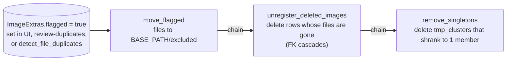

# Use case: maintenance and cleanup

Status: draft (verified 2026-10-10).

## Removing images from the library

| Step | Run-tracked | Admin | Skip chain |
|---|---|---|---|
| `move_flagged` | `move_flagged` | yes | `--no-chain` |
| `unregister_deleted_images` | `unregister_deleted_images` | yes | `--no-chain` |
| `remove_singletons` | no (prints metrics) | no | n/a |

Name collisions in `excluded/` are resolved by renaming, not overwriting (`move_without_overwrite`). Missing files are
counted as `error.file_not_found` and skipped. If you only want the reconcile after deleting files by hand, run
`unregister_deleted_images` alone.

## Format fixes

`fix_image_formats --status active` applies the ingestion format logic to the existing corpus: renames extension
mismatches, converts WebP content to JPEG (originals to `BASE_PATH/converted_originals/`). It is also the only path
that backfills `Image.width/height` for images registered outside the ingestion pipeline (those never pass
`apply_format_fix()`), which `classify_text_heavy` needs. It is run-tracked with the wrapper contract but absent from
the registry, so it is shell-only today. Each image's failure is isolated from the rest of the run.

## OCR upkeep

| Task | Command |
|---|---|
| Re-OCR everything without losing data | `python -m batch.reset_ocr_status --all`, then `python -m batch.extract_text_from_memes` |
| Backfill `lang_score` for old rows | `python -m batch.score_ocr_language [--rescore-all]` |
| Remove duplicate OCR text rows | `python -m batch.deduplicate_ocr_texts` |
| Evaluate language filter / tagging rules | `batch/eval_ocr_language_filter.py`, `batch/eval_rules.py`, `batch/diff_rules.py` |

## Backfills worth remembering

| Need | Command |
|---|---|
| `content_hash` for the existing corpus (once per environment, before ingestion) | `detect_file_duplicates --env E` |
| Width/height | `fix_image_formats` |
| New taxonomy version or prompts | rerun `build_meme_profiles` (stale profiles re-extract; human-verified ones are only reported) |
| Statistics snapshot | `build_statistics`, or open the statistics page (`?live=true`) |

## Intake helpers (ad hoc)

`load_images_from_internet` (SerpAPI, needs `SERP_API_KEY` in the env file) and `move_reference_duplicates` (drop files
from a reference folder that already exist in the library) are manual one-offs with no tracking.

## Windows operational hazards

- Set `PYTHONIOENCODING=utf-8` before any interactive run that uses `ProgressTracker`, or a `UnicodeEncodeError` on the
  `≈` character can crash a job mid-run and leave partial results committed.
- Tool-call background runs are killed at about 10 minutes; use `--limit`, or launch a detached process, for long jobs.
- Before restarting an always-on backend, run `pip check` in `.venv311` (killed installs leave `~`-prefixed orphan
  package directories; see CLAUDE.md gotchas).
