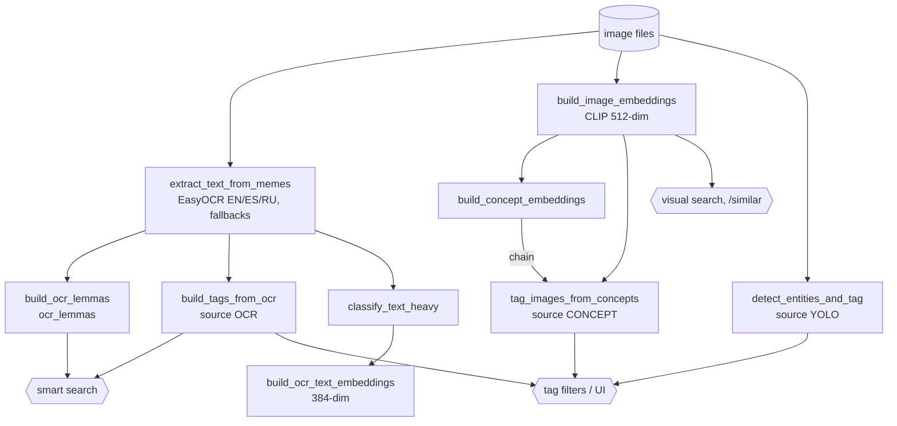
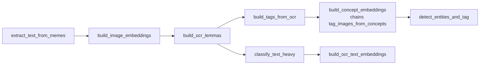

# Use case: OCR, lemmatisation and tagging

Status: draft (verified 2026-10-10). Signal-to-consumer matrix: `docs/data-flow.md`. Tagging engine:
`batch/rules_engine.md`.

Execution order (Graphviz): [diagrams/tagging-and-lemmas.svg](../diagrams/tagging-and-lemmas.svg)

Goal: turn raw image files into searchable text signals (OCR text, lemmas), visual signals (CLIP) and tags.

## Dependency graph

Smart search matches a query lemma against `ocr_lemmas`, `image_tags`, `description_note_lemmas` and
`description_lemmas` (see [descriptions-and-profiles.md](descriptions-and-profiles.md)).

## Recommended order for a full library pass

Steps A to C are also what ingestion runs for `pending` images (see [ingestion.md](ingestion.md)). Apart from
`classify_text_heavy` before `build_ocr_text_embeddings`, the later steps have no hard ordering between each other.

## Jobs

| Job | Reads | Writes | Re-run behaviour | Run it |
|---|---|---|---|---|
| `extract_text_from_memes` | files, `images` | `ocr_texts` (per image, per language) | Processes images without OCR status. Full re-run: `python -m batch.reset_ocr_status --all`, then rerun. Never truncate `ocr_texts` | shell, admin (always `active`), `--status {pending,active,all}` |
| `build_image_embeddings` | files | `embeddings` | `--incremental` skips embedded images. Admin and scheduler runs are always incremental and `active` | shell, admin |
| `build_ocr_lemmas` | `ocr_texts` | `ocr_lemmas` | `--incremental` skips indexed images. **A full run deletes the entire table**, even with `--status pending`, so pending requires incremental | shell, admin (always incremental) |
| `build_tags_from_ocr` | `ocr_texts` (after confidence and language-plausibility filters) | `image_tags` source `OCR` | `--incremental` skips images that already have an `OCR` tag. Full run deletes all `OCR` tags first | shell, admin (incremental) |
| `build_concept_embeddings` | `CONCEPTS.*` files, concept images | concept vectors and mappings | Full rebuild; **chains** `tag_images_from_concepts` | shell (`--no-chain`), admin |
| `tag_images_from_concepts` | CLIP embeddings, concept vectors | `image_tags` source `CONCEPT` | Full rebuild | shell, admin |
| `detect_entities_and_tag` | files | `image_tags` source `YOLO` | Full rebuild | shell, admin |
| `classify_text_heavy` | OCR text, dimensions | `image_classifications` | Only images without a classification | shell, admin |
| `build_ocr_text_embeddings` | OCR text of text-heavy images | `ocr_text_embeddings` | Incremental | shell, admin |

Ownership rule for tags: every job owns exactly one `source` string and a full run deletes only its own source.

## Tagging engine

`rules/concept_tagger.py` (concept voting, YAML in `batch/data/tagging/`: `concepts.<profile>.yaml` and
`tags.<profile>.yaml`). Used by `build_tags_from_ocr`, `build_tags_from_descriptions`, `build_tags_from_notes`.
Profile = `GENERAL.TAGGING_PROFILE`. Files exist for `metal` and `general` only, so these three jobs cannot run
on `it`. The legacy `rules/engine.py` is used only by dev tools (`diff_rules`, `batch/tools/*`).
`rules/normalize.py` is shared by both engines and `build_bow`; after changing it, run the whole
`tests/integration/` root (see CLAUDE.md gotchas).

## Lemmatisation notes

- Lemmas are language-gated (see specs 2026-07-17 and 2026-07-26).
- OCR lemmas also gate the OCR-text duplicate probe (lexical corroboration), so they matter beyond search.
- Description lemmas and note lemmas are separate indexes with separate jobs.

## Environment caveats

| | metal | general | it |
|---|---|---|---|
| ConceptTagger jobs | yes | yes | no (no tagging YAML) |
| Concept files | `data/text-concepts.metal.json` | `data/text-concepts.general.json` | common defaults |
| Scheduling | none | none | none |

## Scheduling

None of these are scheduled in any environment. All but OCR and CLIP embeddings are admin-triggerable, so a newly
promoted image gets tags and lemmas only after someone runs the jobs (or `description_pipeline`, whose first step is
`build_tags_from_ocr`).
