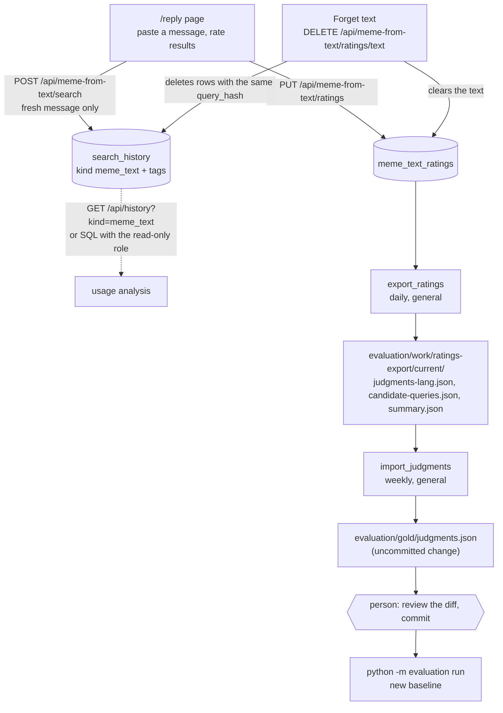

# Use case: ratings, the query log and the gold set

Status: draft (verified 2026-10-11). Spec: `2026-10-02-meme-from-text/2026-10-10-query-log-and-gold-set-jobs-design.md`
(builds on `2026-10-09-p5b-rating-widget-design.md` and `2026-10-03-p6-evaluation-and-gold-set-design.md`).

Execution order (Graphviz): [diagrams/ratings-and-gold-set.svg](../diagrams/ratings-and-gold-set.svg)

Goal: turn what the owner does on the `/reply` page (pasting a message, rating the results) into material for the
meme-from-text gold set, and keep a log of the messages for usage analysis. Two jobs do the batch part. Both run on
`general` only (the frozen gold corpus belongs to `general`) and are the only scheduled jobs that differ between
environments. Neither ever commits anything.

| Job | Kind | Interval (`general`) | Orphan timeout | Reads | Writes |
|---|---|---|---|---|---|
| `export_ratings` | `export_ratings` | daily (1440 min) | 10 min | `meme_text_ratings`, `evaluation/gold/` | `evaluation/work/ratings-export/current/` (replaced each run, git-ignored) |
| `import_judgments` | `import_judgments` | weekly (10080 min) | 10 min | `evaluation/work/ratings-export/current/judgments-*.json` | `evaluation/gold/judgments.json` (working tree, uncommitted) |

Both are also in `environments/batch_registry.yaml`, so they can be started from `/admin/batches` on any environment;
elsewhere than `general` they finish with `skipped: true` ("not configured for this environment").

## The flow

1. **Query log.** `POST /api/meme-from-text/search` records one `search_history` row (`kind = 'meme_text'`) per
   fresh message after a successful pipeline call: the text, language, parsed situation, `query_hash`, `degraded` /
   `fallback`, `parse_ms` / `retrieval_ms`, the result count and the parsed axes as `search_history_tags` rows. Not
   recorded: "Show more" pages (cursor), edited readings (`profile`), filter toggles, an unavailable pipeline (`it`),
   or when `search.meme_from_text.query_log.enabled` is false. The write is best effort and never fails a request.
2. **Ratings.** The owner rates each result on `/reply`; one row per message hash and image in `meme_text_ratings`.
3. **`export_ratings`** (daily, `general`): writes `judgments-<lang>.json`, `candidate-queries.json` and
   `summary.json` into `evaluation/work/ratings-export/current/`, replacing the previous export. The round number is
   the highest round in `judgments.json` plus 1. Pairs that already have a judgment are left out, so the next step
   only adds. Run stats: ratings, importable, round.
4. **`import_judgments`** (weekly, `general`): merges the `judgments-*.json` files of `current/` into
   `evaluation/gold/judgments.json` with an atomic write (temp file, rename). It never overwrites an existing judgment
   (the run fails instead), never commits, and with an empty or missing `current/` it succeeds having done nothing.
   Its stats name the changed file and say the change is uncommitted.
5. **A person** looks at `git diff evaluation/gold/judgments.json`, commits it, and records a fresh baseline with
   `python -m evaluation run --retriever fused --parse-model M --label L` (read-only DB role). Baselines recorded
   before the merge carry the old `judgmentsSha`, so compare across the merge with care
   ([gaps-and-findings.md](../gaps-and-findings.md), B14).

## Reading the query log

- `GET /api/history?kind=meme_text` (`kind` is `search` by default, `meme_text` or `all`); rows carry `queryHash`,
  `language`, `situation`, `degraded`, `fallback`, `parseMs`, `retrievalMs`.
- Or SQL on `search_history` with the read-only role (`DATABASE_URL_READONLY`, role `ocr_readonly`).
- There is no UI and no retention: rows stay until someone uses "Forget text" or the setting is turned off.

## Forget text

`DELETE /api/meme-from-text/ratings/text` clears the stored message text of a rating (the grades stay) and now also
deletes the `search_history` rows of `kind = 'meme_text'` with the same `query_hash` (their tags cascade). The text is
never written to application logs or error bodies. Caveat: every fresh message is logged, but the `/reply` page shows the Forget button only once a message has a rating (the API call works for any message hash).

## Operating notes

- Turning logging off: `search.meme_from_text.query_log.enabled: false` (tracked settings, takes effect on restart).
- Disabling a job: set `enabled: false` on its entry under `scheduler.jobs` in `environments/settings.general.yaml`.
- The jobs need the repository checkout (`evaluation/`, `batch/`); the backend Docker image does not carry it and runs
  with the scheduler off.
- First scheduled export after a backend start appears one interval later (the first tick waits out the interval).
