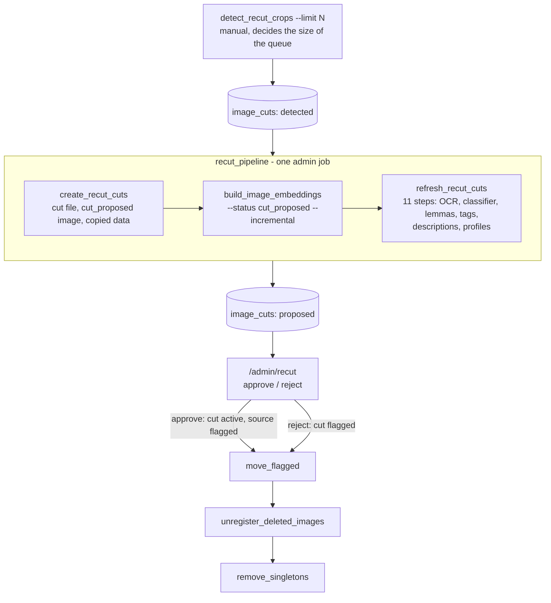

# Use case: screenshot recut

Status: draft (written 2026-10-29, not yet run against a live database). Epic: `docs/superpowers/specs/2026-10-17-screenshot-recut/README.md`;
operations design: `2026-10-29-r7-operations-and-evaluation-design.md`.

Some memes are saved as screenshots with a flat border around the picture. The recut finds them, cuts the picture out as a
new `cut_proposed` image that inherits the original's data, and lets the owner approve or reject each cut on `/admin/recut`.
An approved cut becomes the library image and its source leaves through the normal flag, move and unregister path. Nothing is
removed before an explicit approve. Image statuses: `docs/image-status.md`; what a cut inherits: `docs/image-derived-data.md`.

## The path

## What runs where

| Job | Admin-triggerable | Notes |
|---|---|---|
| `detect_recut_crops` | yes | `--limit` on the shell; the admin trigger has none. Checks each image once per detector version (`recut_detect_v1`) |
| `recut_pipeline` | yes | The three steps below in one run-tracked job; each child also self-tracks under its own kind. `recut.max_cuts_per_run` caps the cut step |
| `create_recut_cuts` | yes | `--limit`; `--retry-failed` (shell only) puts `failed` proposals back to `detected` after a drive or database outage |
| `build_image_embeddings --status cut_proposed --incremental` | through `recut_pipeline` | The admin trigger of the job itself stays `--status active` |
| `refresh_recut_cuts` | yes | Replaces the stale data the cuts inherited; also runs from `recut_pipeline` |
| `move_flagged` | yes | Chains `unregister_deleted_images`, which chains `remove_singletons`. Moves flagged files whatever their status, so a rejected cut goes to `excluded/` too |

## Reviewing

- Open `/admin/recut`. The queue holds the `proposed` cuts, highest detector confidence first; keys `A` approve, `R` reject, the
  arrows step. A decision moves no file; removal is the `move_flagged` chain. An approval also copies the source to
  `pre-cuts/` (below).
- The "Review so far" table shows, per confidence band, how many cuts wait, were approved and were rejected, and the approve
  rate. Read it next to `python -m evaluation recut-report`, which prints the precision measured on the labelled sample (no
  database needed). The approve rate is stricter than the gold "as is or slightly off" precision, because a slightly-off box can
  still be rejected, so the two are not compared one to one.
- Run `recut_pipeline` (so the refresh has run) before approving. The refresh modes select `cut_proposed` images only, so a cut
  approved while its copied OCR, lemmas, tags and descriptions are still stale becomes `active` and is not refreshed by
  `refresh_recut_cuts` afterwards; those rows would stay stale in the library. (Widening the refresh to `active` cuts would be
  a code change, not made in R7.)

## Adjusting a box

A box that is slightly off can be corrected before approving (R6). On `/admin/recut` press **Adjust**: drag the rectangle or its
eight handles, or type exact values in the x, y, w and h fields (pixels of the source; each side at least 16, inside the image).
**Apply** rebuilds the cut inside the request from the corrected box; **Cancel** (or `Esc`) leaves it unchanged; **Reset to
detected box** (shown after a first adjustment) puts the detector's box back into the fields, and Apply sends it. While the box is
edited Approve, Reject and the keys are off.

- An adjusted cut is a NEW `cut_proposed` image copied from the source like the first one, so its OCR, lemmas, tags and
  descriptions are stale again: **run `recut_pipeline` before approving** (the page says so after Apply). The previous cut image
  and its file are removed.
- **Do not adjust while `recut_pipeline`, `refresh_recut_cuts` or `create_recut_cuts` is running** (check `/admin/batches`).
  Adjusting deletes the old cut image and its file; a running job may be reading that file or about to write rows for that
  image id, so the job can fail on that image (or on its commit chunk). Nothing refuses this for you. If it happens, adjust again
  or trigger `recut_pipeline` again: every step selects only what is still waiting.
- The detector's confidence stays the value for its original box; the "Adjusted" column of the statistics table and the
  `adjusted` / `adjusted_share` metrics on `/admin/batches` count how often boxes were corrected.
- Refusals: the proposal was already decided, the source changed after detection (`source_changed`; the cut is not rebuilt from
  a different file), the source is gone, inactive or flagged, or the box does not fit.
- The backend process needs to write into `BASE_PATH` (cut files and `pre-cuts/`): a read-only mount makes every adjustment fail
  with `write_error` (HTTP 500) and an approval skip its backup copy (logged).

## pre-cuts

Every approval copies the source file to `BASE_PATH/pre-cuts/<same filename>` after the commit (`shutil.copy2`, never
overwriting an existing file; a failed copy is logged and does not fail the approval). Rejected and undecided proposals copy
nothing. It is a backup of the original before `move_flagged` moves the source to `excluded/`. Nothing purges `pre-cuts/` and no
batch job reads it; delete it by hand when the backups are no longer wanted.

## After a failed step

Trigger `recut_pipeline` again. Every step selects only what is still waiting, and a failed step never stops the others.
`create_recut_cuts` stops after 20 failures in a row; its stats say why a proposal failed (`source_missing`, `source_changed`,
`unreadable`, `write_error`).

## Duplicates

A recut source and its cut are never inserted as a duplicate candidate pair (`find_duplicates`, R5b). If a third copy exists, the
source, the cut and the copy can still share a cluster on `/duplicates` until `move_flagged` and `unregister_deleted_images`
have removed the source (known limit, R5b spec).

## Scheduling

No recut job is scheduled, by decision (R7). Review, not detection, is the bottleneck: margin trims are about 27% of the sampled
library, so the first pass is a queue of thousands. Detection is already bounded, since each image is checked once per detector
version. Revisit once the first pass is reviewed and the queue is empty: scheduling `detect_recut_crops` and then
`recut_pipeline` weekly on `general` only is then a settings change.

## First rollout

Nothing here has run against a live database. Every step needs the owner's explicit go-ahead.

1. Migrations in order: R1 `b8d4f1a6c935`, M1 `c5e2a9d7b140`, R3a `d7a3b9e2c451`, R6 `e9c4a7b3d812` (its parent is the popularity
   migration `c8e2f5a1d093`), checked against the current alembic head.
2. A confirmed backup, one environment at a time, each verified with the read-only role.
3. A first limited `detect_recut_crops --limit 500` on `general`, then `recut_pipeline`, then review a few dozen cuts.
4. A visual check of the box overlay on a tall source image in a real browser, and of the Adjust mode: the eight handles and
   the body line up with the box on a tall and a wide image, dragging is smooth, and it works with touch (jsdom cannot test
   layout, so none of this is covered by the automated tests).
5. The `refresh_recut_cuts` GPU steps (OCR, descriptions) have never run for real; watch the first run.
6. The backend deployment can write into `BASE_PATH` (adjusting a box writes a new cut file; approving writes `pre-cuts/`).
   The backend image carries Pillow for this; rebuild it before the first adjustment.
