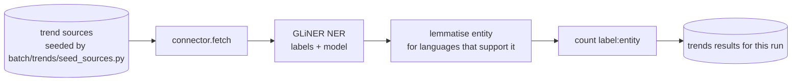
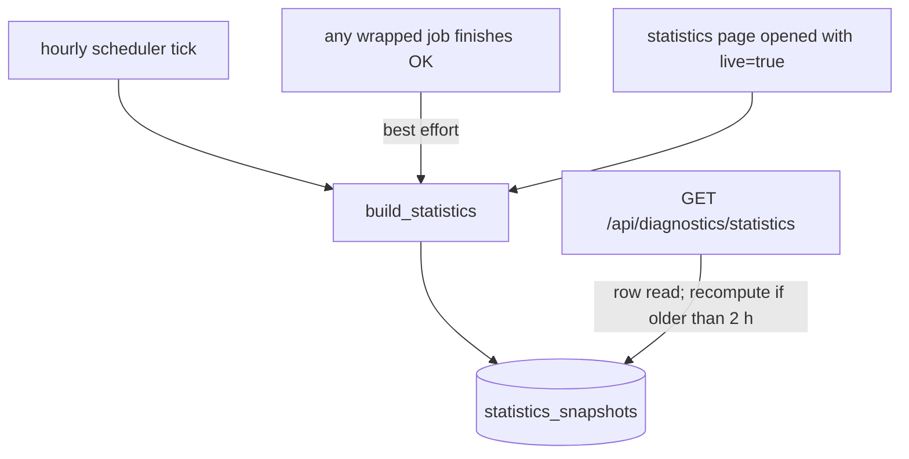

# Use case: trends and statistics (the scheduled jobs)

Status: draft (verified 2026-10-10). Specs: `2026-07-12-generalize-trends-pipeline-design.md`,
`2026-07-27-batch-job-scheduler-design.md`, `2026-09-29-precomputed-statistics-design.md`.

These are the only two jobs on `scheduler.jobs`. They run in the backend process of **each** environment
(`scheduler.enabled: true` in all three per-environment settings files).

| Job | Kind | Interval | Orphan timeout | Reads | Writes |
|---|---|---|---|---|---|
| `trends_batch` | `trends` | 6 h | 60 min | configured trend sources (RSS/API connectors) | per-run results for the Trends UI/API |
| `build_statistics` | `statistics` | 1 h | 10 min | the library tables | single-row `statistics_snapshots` (`name='corpus'`) |

## trends_batch

Labels, model and language resolve per source first (`source.extraction`), then fall back to `trends.labels`,
`trends.model`, `trends.language` for the environment. metal: `band, music genre, person` with
`gliner_medium-v2.1`; general: `person, organization, location` with `gliner_multi-v2.1`; **it: no defaults**, so sources
there must carry their own extraction config (not checked against the `it` database). Results written before a failure
are still committed. Seeding sources is a separate manual step and not part of the run.

## build_statistics

Changes that happen outside any batch (flagging, description feedback, ingestion promote or reject) are picked up by
the next hourly run; there is no per-mutation invalidation by design.

## Operating the schedule

- Disable one job in one place by editing `scheduler.jobs[].enabled` (it is shared by all environments) or turn the
  whole scheduler off with `scheduler.enabled: false` for an environment.
- Adding a job needs: a tracked `main(trigger, run_id)`, a registry entry, and a `scheduler.jobs` entry whose
  `batch_run_kind` equals the job's tracked kind. Missing keys cause that entry to be skipped with an error log, not a
  backend crash.
- A backend restart does not re-fire a job early: the first tick waits for the remainder of the interval.
- The scheduler's child process keeps running if the backend restarts. The restarted backend will see the `started`
  row and skip until it ends or exceeds the orphan timeout.
